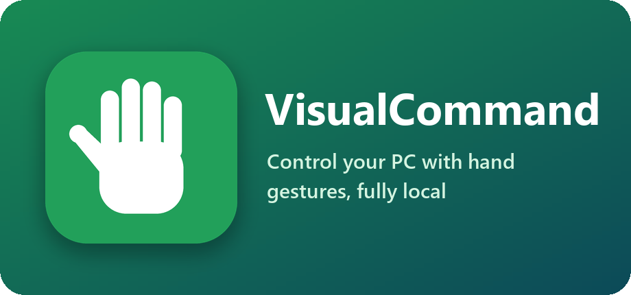
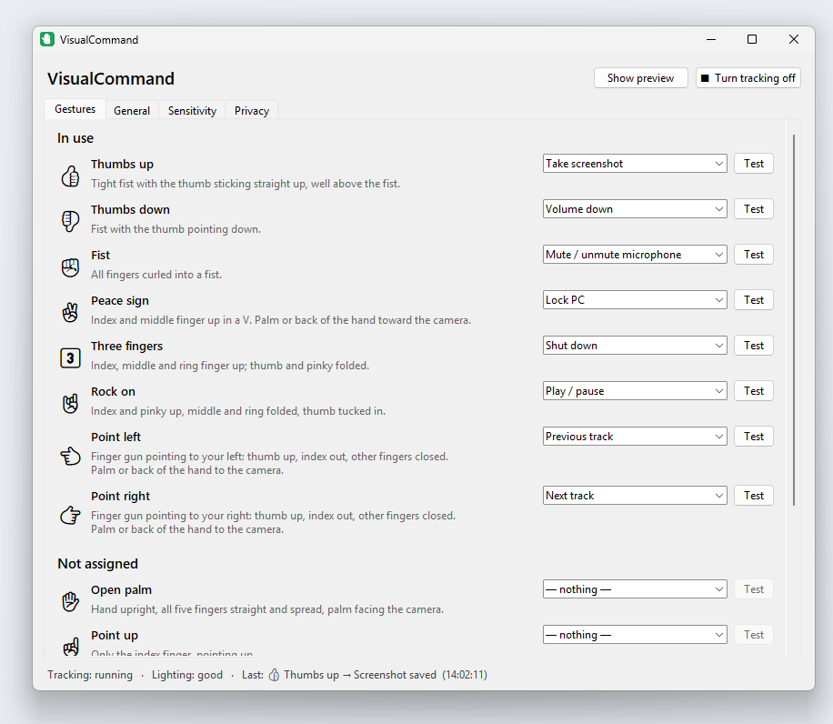
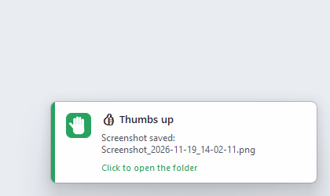
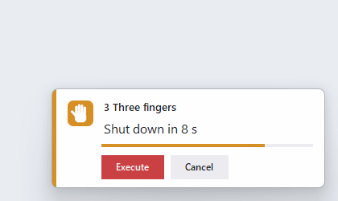

<p align="center">
  
</p>
<p align="center">
  
  
  <a href="LICENSE"></a>
</p>

# VisualCommand

Control your PC with hand signs to your webcam. Show a thumbs up and it takes a screenshot; make a
fist and your microphone mutes; flash a peace sign and the PC locks. You pick which gesture does what.

VisualCommand sits quietly in the system tray (the **^** at the bottom right of the taskbar) and
watches for a small set of hand poses. **Everything runs on your own PC.** Hand tracking uses Google's
[MediaPipe](https://github.com/google-ai-edge/mediapipe) model, which ships inside the app. There's no
account and no cloud, it only goes online when you ask it to check for updates, and **no camera picture
is ever saved**.

<p align="center">
  
</p>

## Why it's nice to live with

- **Private by design.** Camera frames are analysed in memory and dropped straight away. They're never
  written to disk, logged or sent anywhere. The only network access is the update check, and only when
  you ask for it. Tests fail the build if code that saves images creeps in, or if anything other than
  the updater tries to go online.
- **Only deliberate gestures count.** A gesture has to be held steadily for a moment, with your hand
  raised into the view and clearly shown to the camera. A hand resting on the desk, holding a cup or
  propping up your chin doesn't trigger anything. Every rule was tuned on real recordings of real
  hands.
- **Safe for big actions.** Shut down, restart and sleep never happen straight away: a popup counts
  down 10 seconds with **Execute** and **Cancel** buttons.
- **Light on your PC.** It checks the camera a few times a second while no hand is in view, about 0.5–3%
  CPU, and releases the camera entirely (its light goes off) when tracking is off, paused or the PC is
  locked.
- **Works with either hand** (the peace sign and the finger guns also with the back of your hand), and
  in dim rooms: frames are brightened in memory when needed.

## Using it

1. **Install** VisualCommand (see below) and start it. A hand icon appears in the tray: green means
   it's watching, grey means tracking is off, amber means paused, locked or the camera is busy.
2. **Left-click the tray icon** to open the window. In the **Gestures** tab, choose an action for each
   gesture you want to use. Gestures you've assigned move to the top; the rest stay below and cost
   nothing. **Test** runs an action straight away, so you can try it.
3. **Make the gesture** with your hand raised in front of the camera and hold it for about half a
   second. You'll hear a short chime and see a small popup confirming what happened. To repeat a
   gesture, lower your hand or change pose first.

Out of the box: 👍 takes a screenshot, ✊ mutes or unmutes your microphone, and ✌️ locks the PC.

<p align="center">
  
  &nbsp;
  
</p>

Right-click the tray icon to turn tracking on or off, show the camera preview, pause for 10 minutes,
open your screenshots or the trigger logs, or quit.

### Gestures

| | Gesture | How to make it |
|---|---|---|
| 👍 | Thumbs up | Tight fist, thumb sticking straight up |
| 👎 | Thumbs down | Fist, thumb pointing down |
| ✊ | Fist | All fingers curled in |
| ✋ | Open palm | Hand upright, fingers straight and spread, palm facing the camera |
| ✌️ | Peace sign | Index and middle finger up in a V (palm or back of the hand) |
| ☝️ | Point up | Only the index finger, pointing up |
| 🤟 | I love you | Thumb, index and pinky out |
| 🤏 | Pinch | Thumb and index fingertips touching |
| 👌 | OK sign | Thumb and index make a circle, other three fingers up |
| 3️⃣ | Three fingers | Index, middle and ring finger up |
| 🤘 | Rock on | Index and pinky up, thumb tucked in |
| 🤙 | Call me | Thumb and pinky out |
| 👈 | Point left | Finger gun pointing to your left (thumb up, index out) |
| 👉 | Point right | Finger gun pointing to your right |

### Actions

| Group | Actions |
|---|---|
| **System** | Take screenshot (your main display, saved to `Pictures\VisualCommand`; click the popup to open the folder) · Lock PC · Turn display off · Show desktop · Task view · Open screenshots folder · Open app / file / command… |
| **Media** | Play / pause · Next track · Previous track · Volume up / down (changes **the app that's playing**, e.g. Spotify, not the whole PC) |
| **Audio** | Mute / unmute microphone · System volume up / down · Mute / unmute speakers |
| **Power** | Shut down · Restart · Sleep (each after a 10-second countdown you can cancel) |
| **VisualCommand** | Pause tracking for 10 minutes |

### Settings worth knowing

- **Sensitivity → Gesture zone:** how high your hand has to be raised for a gesture to count. Make it
  bigger if real gestures are missed, smaller if a resting hand still triggers.
- **Show preview** (top of the window or tray menu) shows the hand skeleton, what each hand reads as,
  the gesture-zone line and, if a hand isn't counted, why ("hand too low", "hand partly out of
  view"...). It's for checking tracking and is never recorded.
- **General → Left / right hand:** if gestures work with one hand but not the other, click **Check
  camera orientation** and raise your right hand. Some cameras deliver a mirrored picture.
- **General → Safety gesture:** if you want extra protection, choose a pose that has to be shown first;
  other gestures then only work for a few seconds after it.
- **General → Start with Windows**, popups, sounds, camera choice and low-light boost.

## Your privacy

- **Camera frames stay in memory** for one analysis step and are then dropped. The preview window is
  not recorded either.
- **Offline unless you check for updates.** The hand model is bundled and loaded from disk. The app
  only goes online when you click **Check for updates** (or turn on the once-a-day check, which is off
  by default): it asks GitHub for the latest release and, if you choose to update, downloads the
  installer. Nothing about you or your gestures is sent.
- **The camera is released** whenever tracking is off or paused and while the PC is locked.
- **What is written to disk:** your settings and a small text log (gesture names only) in
  `%APPDATA%\VisualCommand`, the screenshots you ask for, and the **trigger log**: each time a
  gesture triggers an action, a few KB of hand-tracking *numbers* (21 hand points, scores, which action
  ran) are saved to help track down false triggers. Each record is deleted after 24 hours, and you can
  turn the trigger log off in **General**.

## Install

1. Download `VisualCommand-Setup-<version>.exe` from the
   [latest release](https://github.com/boraswim/VisualCommand/releases/latest).
2. Run it. It installs for your Windows user only (no admin prompt), adds a Start menu entry and, if
   you leave the box ticked, starts VisualCommand when you sign in. Windows SmartScreen may warn about
   an unknown publisher the first time, because the installer isn't code-signed: click **More info →
   Run anyway**.
3. Start VisualCommand. It opens straight into the tray.

**Updating:** click **Check for updates** in the **General** tab (or the tray menu), then **Update
now**. VisualCommand downloads the new installer from this repository's releases, checks it matches
the published checksum, installs it and restarts, keeping your settings. You can also turn on a check
once a day. Running a newer installer by hand does the same. Uninstall it from **Settings → Apps**;
you'll be asked whether to delete your settings too.

You'll need Windows 10 or 11 (64-bit) and a webcam.

### From source

Requires Windows, Python 3.11 and [uv](https://docs.astral.sh/uv/):

```
uv venv .venv -p 3.11
uv pip install --python .venv\Scripts\python.exe -e ".[dev]"
.venv\Scripts\python.exe scripts\fetch_model.py
.venv\Scripts\python.exe -m visualcommand
```

`fetch_model.py` downloads MediaPipe's gesture model (about 8 MB) into `models/` once; that's the
only download, and it happens at build time, never in the app. Add `--verbose` for a detailed log or
`--bench` for CPU, memory and frame-rate figures every 10 seconds. Run the tests with
`.venv\Scripts\python.exe -m pytest -q`.

To build the installer, install [Inno Setup 6](https://jrsoftware.org/isinfo.php)
(`winget install JRSoftware.InnoSetup`) and run:

```
powershell -ExecutionPolicy Bypass -File scripts\build.ps1
```

It runs the tests, builds the app with PyInstaller into `dist\VisualCommand\`, and writes
`installer\Output\VisualCommand-Setup-<version>.exe`.

## Adding your own gestures and actions

Both are plugins: drop a class or function into any module under `visualcommand/gestures/` or
`visualcommand/actions/` and it appears in the settings window, with no UI changes needed.

```python
from visualcommand.gestures.base import PoseGesture, register_gesture

@register_gesture
class ThumbLeft(PoseGesture):                # return a 0..1 score for every frame
    id, name, icon, order = "Thumb_Left", "Thumb left", "👈", 30
    description = "Fist with the thumb pointing to your left."

    def score(self, f):
        thumb_only = f.extended == (True, False, False, False, False)
        return 0.9 if f.hand and thumb_only and f.landmarks[4][0] < f.landmarks[2][0] else 0.0
```

`f` is a `FrameFeatures` with the 21 hand points (`landmarks`, in your point of view: x grows to your
right), which fingers are out (`extended`: thumb, index, middle, ring, pinky), MediaPipe's own pose
(`mp_label`, `mp_score`), left/right (`handedness`) and ready-made measures such as `pinch`,
`palm_facing`, `thumb_index_angle` and `index_dir`. Hold time, cooldown and the "is the hand really
shown to the camera" checks are handled for you.

```python
from visualcommand.actions.base import Param, register_action

@register_action("open_url", "Open a website", group="System",
                 params=(Param("url", "URL", "https://example.com"),))
def open_url(ctx, params):
    import os; os.startfile(params["url"])
    return f"Opened {params['url']}"         # shown in the popup
```

Add `confirm_seconds=10` to `register_action` for anything that can't be undone, and it gets the
countdown popup automatically. For tuning gestures on real data, `scripts/diagnose_false_triggers.py`
records hand-tracking numbers (never images) and `scripts/replay_trigger_logs.py` replays trigger logs
against the current rules.

## Code

| Path | Job |
|---|---|
| `visualcommand/main.py` | Starts the app: tray, camera thread, settings window, popups, actions |
| `visualcommand/tracker.py` | Camera thread: adaptive frame rate, lighting, MediaPipe, preview |
| `visualcommand/features.py` | Turns MediaPipe's hand points into measures (fingers out, pinch, palm facing...) |
| `visualcommand/deliberate.py` | "Is the hand really shown to the camera?" (gesture zone, size, angle) |
| `visualcommand/engine.py` | Hold time, steadiness, cooldown, re-arm and the safety gesture |
| `visualcommand/hands.py` | Two hands at once: keeps each hand's state apart, drops phantom hands |
| `visualcommand/gestures/` | The gesture catalogue (plugins) |
| `visualcommand/actions/` | The action catalogue (plugins) |
| `visualcommand/lighting.py` | Lighting check and in-memory brightening for dim or backlit rooms |
| `visualcommand/settings_ui.py`, `tray.py`, `toast.py` | Settings window, tray icon, popups |
| `visualcommand/triggerlog.py` | The 24-hour trigger log |
| `visualcommand/updater.py` | Update check and install from GitHub releases (the only network code) |
| `visualcommand/config.py`, `winutil.py` | Settings file and migrations; Windows helpers (single instance, lock state, autostart) |
| `installer/VisualCommand.iss`, `VisualCommand.spec`, `scripts/build.ps1` | Packaging |
| `scripts/` | Developer tools: model download, icon, sounds, README images, recorders and replays |

## Contributing

Bug reports, new gestures and pull requests are welcome: see [CONTRIBUTING.md](CONTRIBUTING.md). If a
gesture fires by mistake, the trigger log files are the most useful thing you can attach. Please report
security problems privately, as described in [SECURITY.md](SECURITY.md).

## License

VisualCommand is released under the [MIT License](LICENSE): you may use, copy, change and share it,
including in other projects, as long as the copyright notice comes along. Copyright (c) 2026 Bora Sevim.

The installer also contains other projects, which keep their own licences: MediaPipe and its gesture
model, and OpenCV (Apache 2.0); NumPy, psutil and Pillow (BSD/MIT-style); mss, pycaw and comtypes (MIT);
and [pystray](https://github.com/moses-palmer/pystray) (LGPL-3.0), which draws the tray icon. Under the
LGPL you're free to replace pystray with your own version: the installer ships it as plain Python
files in the app's `_internal\pystray` folder. The notification sounds are made from Kenney's
[Interface Sounds](https://kenney.nl/assets/interface-sounds) (CC0).
